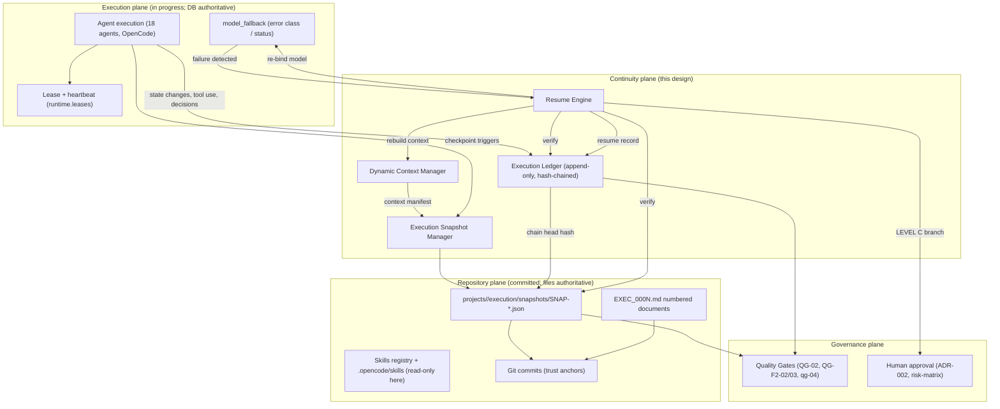
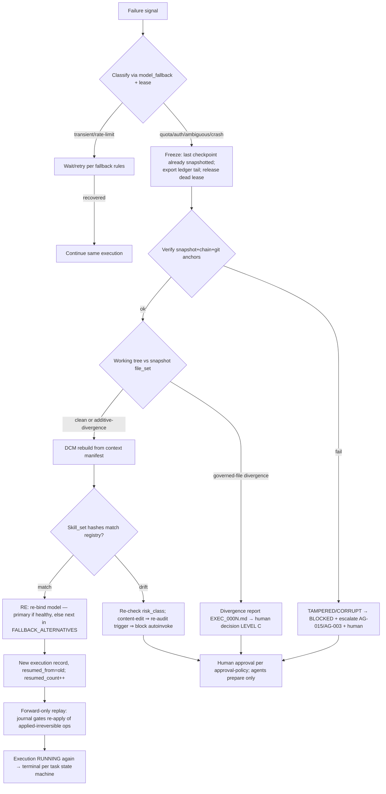

# Execution Continuity & Recovery Architecture

- **doc_id**: EXEC-ARCHITECTURE-0001
- **file**: `docs/execution/EXECUTION_ARCHITECTURE.md`
- **created_at**: 2026-11-19
- **author**: AG-005 Software Architect
- **stage**: 2A — Dynamic Context, Execution Continuity & Recovery Architecture
- **status**: ARCHITECTURE DESIGN — normative candidate for ratification by ADR ≥ ADR-007. **Nothing described here is implemented.** This document adds no runtime code, changes no agent, schema, policy, or config, and claims no validation PASS for work not performed.
- **inputs read**: `AI_START_HERE.md`, `PROJECT_CONTEXT.md`, `PROJECT_STATUS.md`, `PROJECT_HANDOFF.md`, `PROJECT_DECISIONS.md` (ADR-001…ADR-006), `docs/architecture/ADR-R5.2A-SOURCE-OF-TRUTH.md` (Proposed), `contracts/execution-contract.md`, `schemas/execution.schema.json`, `orchestration/state-management/*`, `orchestration/policies/context-policy.md`, `orchestration/policies/model-portability-policy.md`, `orchestration/policies/risk-matrix.md`, `orchestration/policies/approval-policy.md`, `orchestration/runtime/runtime.py` (migrations 2–4: hash chains, leases, `resumed_from`, `id_sequences`), `orchestration/runtime/model_fallback.py`, `orchestration/skills/registry.json` (54 entries, verified by count), `orchestration/validators/quality_gate.py`, `orchestration/validators/traceability/traceability.py`, `quality-gates/architecture/qg-02.md`, `quality-gates/f2/qg-f2-02.md`, `quality-gates/f2/qg-f2-03.md`, `docs/skills/SKILLS_GOVERNANCE.md` (doc_id house convention).

---

## 1. Purpose and scope

Define how an agent execution **survives interruption** (crash, timeout, quota exhaustion, model swap, session loss, container restart) and **resumes correctly**, without ever letting hidden runtime state become authoritative and without weakening any existing security control.

In scope: four components (Dynamic Context Manager, Execution Snapshot Manager, Resume Engine, Execution Ledger), the numbered document system `EXEC_000N.md`, data schemas, integrity hashing, the recovery flow, multimodel continuity, and compatibility with the 54 governed skills.

Out of scope: implementation, schema files under `schemas/`, changes under `orchestration/`, `agents/`, `.opencode/`, `quality-gates/`. Requirement gaps found while designing are listed in §12 for escalation, per AG-005 responsibility.

### 1.1 Design posture (inherited, non-negotiable)

1. **Fail-closed** (R5.2A): an unverifiable snapshot, ledger, or recovery path is *blocked*, not *best-effort*.
2. **Evidence over assertion**: every recovery decision traces to a hash, a ledger record, or a committed file.
3. **Forward-only recovery**: resume never rewrites history — no git revert/rebase of anchored commits, no ledger edit, no audit mutation (`audits_no_update` / `events_no_delete` triggers already forbid this).
4. **Supervised autonomy** (ADR-002): recovery steps that delete, overwrite divergent work, or bypass a gate are LEVEL C (`risk-matrix.md`) and require explicit human approval. Agents may prepare but not execute (`approval-policy.md` L12).
5. **Dual source of truth** (per `ADR-R5.2A-SOURCE-OF-TRUTH.md`, itself awaiting ratification as ADR-007): SQLite `orchestration/runtime/runtime.db` is authoritative for *operational state while work is in progress*; committed repository files are authoritative for *normative definitions, evidence, and the closed-stage record*. This architecture adds the **bridge artifacts** (snapshots, ledger exports) between the two, and must be read as compatible with either ratification outcome (§12, gap G-3).

---

## 2. Existing ground: what this design stands on

| Existing mechanism | Location | What this architecture reuses |
|---|---|---|
| Execution status set `PENDING…CANCELLED` | `contracts/execution-contract.md`, `schemas/execution.schema.json` | Ledger event vocabulary keyed to the same states; no new statuses for executions |
| Task/Project state machines with legal transitions | `orchestration/runtime/runtime.py` `TASK_TRANSITIONS`, `PROJECT_TRANSITIONS` | Resume Engine may only re-enter states the machine allows |
| `executions.resumed_from`, `workflow_runs.resumed_count`, `last_resumed_at` | `runtime.py` migration 3 | First-class resume accounting already provisioned; Resume Engine formalizes their use |
| `executions.changed_files`, `file_hashes`, `working_directory`, `before_commit`, `after_commit`, `permission_decisions` | `runtime.py` migration 4 | Snapshot content model (file set + git anchors) mirrors these columns |
| `events` / `audits` hash chain (`prev_hash`, `row_hash`) + immutability triggers | `runtime.py` migrations 3–4, `ADR-R5.2A` §5 | Execution Ledger chain rules use the identical canonicalization and verification contract |
| Leases (`leases` table: `owner_pid`, `heartbeat_at`, `expires_at`) | `runtime.py` migration 4 | Crash/liveness detection trigger for recovery |
| `id_sequences(entity, last_id)` | `runtime.py` migration 4 | Allocation authority for `EXEC_000N` numbers (§5) |
| Single-writer guard: unique index `idx_exec_running` on `executions(task_id) WHERE status='RUNNING'` | `runtime.py` migration 4 | Concurrency rule for resume (§9.4, gap G-6) |
| Model fallback: error classes `quota_exhausted/rate_limit/transient/auth/ambiguous`, statuses `FALLBACK_ACTIVE…NEEDS_INTERVENTION` | `orchestration/runtime/model_fallback.py` | Recovery triage vocabulary and model re-binding (§9) |
| Skills registry: 54 entries with `integrity.file_hashes` (`sha256:`), `permissions`, `reaudit_triggers` incl. `content-edit` | `orchestration/skills/registry.json`, `.opencode/skills/` (54 `SKILL.md`, verified) | Skill-set pinning and drift detection on resume (§10) |
| Stage-closure snapshot convention `projects/<ID>/evidence/<STAGE>/state_snapshot.json` | `ADR-R5.2A` §2 | Execution snapshots are a finer-grained sibling of the same pattern |

**Net-new**: Dynamic Context Manager (assembly/budgeting rules), Execution Snapshot Manager (checkpoint triggers + canonical artifact), Resume Engine (end-to-end recovery procedure), Execution Ledger (repository-committed, chain-hed append record bridging DB events), and the `EXEC_000N.md` document system.

---

## 3. Architecture overview



Data rule: components exchange **artifacts, not memory**. Conversation context, tool session state, and OpenCode session identity are disposable; everything needed to resume is in the snapshot, ledger, and repository files.

---

## 4. Components

### 4.1 Dynamic Context Manager (DCM)

**Purpose**: assemble, budget, and freeze the exact context an agent needs for a task at a point in time, so that context is reproducible and resumable on any model.

- **Assembly tiers** (ordered, each tier a list of *references + content hashes*, never copies of governed content):
  - T0 Bootstrap: the mandatory read order of `orchestration/policies/context-policy.md` (`AI_START_HERE.md` → `PROJECT_CONTEXT.md` → `PROJECT_STATUS.md` → `PROJECT_HANDOFF.md` → `PROJECT_MAP.md`).
  - T1 Task: task record (per `contracts/task-contract.md`), acceptance criteria, bound Quality Gates, agent definition reference (`agents/`, `.opencode/agents/`).
  - T2 Skills: skill entries advertised/invoked for this agent (§10), each pinned by `skill_id` + `sha256` of its content at assembly time.
  - T3 Working set: repository files read or modified so far, with hashes; open defects/findings references; approval records relevant to the task's risk level.
- **Budgeting**: context is token-budgeted by tier priority (T0 always; T1 required; T2/T3 trimmed by recency/relevance with trimmed items *recorded as excluded*, never silently dropped). Follows context-policy compactness rules: references over duplicated blocks.
- **Staleness rule**: every referenced file is fingerprinted at assembly. If a file's hash differs at consumption time (or at resume), DCM marks the manifest `STALE` and re-assembles; an execution may not run on a stale manifest when the stale file is a contract, schema, policy, or gate definition.
- **Output**: a **context manifest** (schema §6.2). The manifest is the input contract of snapshots: a snapshot without a manifest hash is not resume-eligible.
- **Boundary**: DCM assembles; it authorizes nothing. Permission/approval state is referenced (via `permission_decisions`, approvals) and enforced elsewhere (fail-closed model from R5.2A remains untouched).

### 4.2 Execution Snapshot Manager (ESM)

**Purpose**: freeze a resumable point for one execution as a canonical, hashed, commit-anchored artifact.

- **Checkpoint triggers**:
  1. Execution state transition (per `TASK_TRANSITIONS`/execution status changes).
  2. Before any file-modifying or irreversible-adjacent operation (mirrors `before_commit` / `after_commit` columns).
  3. Every N completed tool/step batches — proposed normative default N=10 (requires ratification; gap G-7).
  4. Degraded signal: `model_fallback` enters `WAITING_*`, `FALLBACK_ACTIVE`, or `NEEDS_INTERVENTION` — snapshot before switching.
  5. Stage closure — the existing `ADR-R5.2A` §2 `state_snapshot.json` remains the stage-level export; execution snapshots are its finer-grained feed.
- **Snapshot content** (schema §6.1): execution/task/agent identity; git branch + `before/after` commit; DCM context manifest + hash; file set `[{path, sha256}]` (aligns with `executions.file_hashes`); pinned skill set (§10); model binding at capture; ledger window `[seq_from..seq_to]` + `chain_head_hash`; resume eligibility flags.
- **Storage**: `projects/<PROJECT_ID>/execution/snapshots/SNAP-<EXEC_000N>-<seq>.json` (repository plane). One snapshot = one canonical JSON document, hashed (§7). Snapshots are written then committed; an uncommitted snapshot is **volatile** and is never the sole resume point.
- **Retention**: snapshots are append-only; superseded snapshots are marked `SUPERSEDED` by a new snapshot recording the pointer, never deleted (deletion would be LEVEL C).

### 4.3 Resume Engine (RE)

**Purpose**: detect that an execution stopped short of a terminal state and bring it forward, on the same or a different model, only when integrity verifies.

- **Detection sources**: expired lease heartbeat; process/session death; `model_fallback` error classification; operator command; audit of `RUNNING` executions with no ledger activity within a declared window.
- **Eligibility (fail-closed)**. A resume may proceed automatically only if ALL hold; otherwise the execution goes `BLOCKED` for human decision:
  1. A committed snapshot exists for the execution with `resume_eligibility.eligible = true`.
  2. Snapshot hash re-verifies against its committed bytes; ledger chain verifies up to the snapshot's `chain_head_hash`; git anchors exist in the repository.
  3. Working tree state matches the snapshot file set, or divergence is *additive and explainable* (only untracked build/test output); any divergence in governed files ⇒ `BLOCKED`.
  4. All operations between last checkpoint and stop point are journalled in the ledger with an `effect` tag; non-idempotent operations recorded as applied are never re-applied.
  5. Task state machine allows re-entry to `RUNNING` (from `BLOCKED`, or `REJECTED`→`RUNNING` per `TASK_TRANSITIONS`).
  6. No second `RUNNING` execution exists for the task (`idx_exec_running` invariant).
- **Procedure**: acquire lease → rebuild context via DCM from the snapshot manifest → re-bind model (§9) → re-verify skill set hashes (§10) → emit `RESUME_REQUESTED` ledger record → start a **new execution record** with `resumed_from = <previous execution_id>` and increment `workflow_runs.resumed_count` / `last_resumed_at` → emit `RESUME_STARTED`. Resume never mutates the dead execution's record.
- **Resume budget**: a third consecutive resume attempt on the same failure signature is not auto-approved; it escalates as `NEEDS_INTERVENTION` (aligns with `model_fallback.FallbackStatus` and pilot lesson: AG-008 timeout required manual completion).
- **Destructive branches** (discard divergent work, rebuild from snapshot over modified files, ledger truncation) = LEVEL C per `risk-matrix.md` L12/L15: agents prepare the remediation plan document (§5) and a human executes/approves.

### 4.4 Execution Ledger (EL)

**Purpose**: the append-only, repository-visible, chain-hashed journal of everything that defines execution continuity — the auditable bridge between the in-progress DB and committed evidence.

- **Two physical views, one logical ledger**:
  - DB view: existing `events` table (`prev_hash`, `row_hash`, immutability triggers) — operational, fast, authoritative *while running*.
  - Repository view: `projects/<PROJECT_ID>/execution/ledger/LEDGER-<EXEC_000N>.jsonl` — one JSONL record per event (§6.3), chain-hashed identically; exported/committed at each checkpoint so the repo always holds the ledger up to the last snapshot.
- **Event vocabulary** (minimum set): `EXECUTION_OPENED`, `STATE_CHANGED`, `CONTEXT_ASSEMBLED`, `SKILL_INVOKED`, `TOOL_USED`, `FILE_CHANGED`, `CHECKPOINT_WRITTEN`, `COMMIT_ANCHOR`, `MODEL_BOUND`, `MODEL_SWITCHED`, `LEASE_EXPIRED`, `FAILURE_CLASSIFIED`, `RESUME_REQUESTED`, `RESUME_STARTED`, `RECOVERY_BLOCKED`, `APPROVAL_REQUESTED`, `EXECUTION_TERMINAL`. Every record: `seq`, `execution_id`, `event_type`, `utc_timestamp`, `actor_agent`, `payload_hash`, `prev_hash`, `record_hash`.
- **Integrity**: chain rules and canonicalization per §7 (same contract as `ADR-R5.2A` §5, so the DB's existing `events`/`audits` chain logic applies unchanged). Timestamps are informational; **chain order, not wall-clock, defines sequence** (clock skew tolerance).
- **Verification**: full-chain recompute at each checkpoint and at every resume; mismatch ⇒ mark execution `TAMPERED`, status `BLOCKED`, escalate to AG-015/AG-003 review and human; no automatic repair, ever.
- **Gate wiring**: `quality_gate.py` evidence readers keep their contract; the ledger and snapshots *feed* evidence directories (test/defect JSON remain the source for verdicts). EL adds `EXECUTION_LEDGER_VERIFIED` as a required input for architecture/release evidence at ratification time; this validator does not exist today and is not claimed to run.

---

## 5. Numbered document system — `EXEC_000N.md`

**Purpose**: give every execution-facing narrative artifact a unique, collision-free, sortable identity matching the factory's document conventions (precedent: `doc_id: SKILLS-GOVERNANCE-0001`, `docs/skills/SKILLS_GOVERNANCE.md`).

- **Name form**: `EXEC_` + exactly 4 zero-padded digits + `.md` (e.g. `EXEC_0001.md`). Underscore distinguishes *documents* from the *execution id* `EXEC-NNNN` mandated by `schemas/execution.schema.json` (`^EXEC-[0-9]{4}$`); mapping is positional: document `EXEC_0042.md` narrates execution `EXEC-0042` within its project scope.
- **Two scopes, separate number series** (ids are allocated from runtime `id_sequences` — `entity` rows `exec_doc_normative`, `exec_doc_operational` — so allocation is transactional and gapless):
  1. **Normative scope**: `docs/execution/EXEC_000N.md` — architecture supplements, schema annexes, recovery runbooks, ratified decision summaries. `EXECUTION_ARCHITECTURE.md` (this file) is doc_id `EXEC-ARCHITECTURE-0001` and serves as the scope index; `EXEC_0001..0099` are reserved for it.
  2. **Operational scope**: `projects/<PROJECT_ID>/execution/EXEC_000N.md` — per-execution reports (plan, outcome, recovery report, divergence report, approval-preparation dossier).
- **Document anatomy** (mandatory sections): metadata block (`doc_id`, `execution_id`, `task_id`, `agent_id`, `created_at`, `status`, `snapshot_refs[]`, `ledger_range` `[seq_from..seq_to]`, `content_sha256` of the body below the metadata block), then Summary / Evidence / Outcome (or Recovery / Prepared-approval for operational docs).
- **Immutability & correction**: committed documents are never edited post-terminal. Corrections are new documents carrying `supersedes: EXEC_000K`; superseded docs get a one-line footer pointer appended *by tooling under change control*, and the ledger records `DOC_SUPERSEDED`.
- **Index**: `projects/<PROJECT_ID>/execution/index.json` maps `EXEC_000N` ↔ execution id ↔ snapshots ↔ ledger file ↔ git commit; rebuilt from the ledger and diffed at stage closure (divergence ⇒ BLOCKED).
- **Capacity note**: 4-digit range gives 0001–9999 per scope per project. Widening to 5 digits would violate the existing execution-id schema — escalated as gap G-1 rather than solved unilaterally.

---

## 6. Data schemas (normative candidates — inline, not written to `schemas/`)

All three are specified here for ratification as JSON Schema draft 2020-12 under `schemas/` **by a later stage**; creating them now is outside this stage's permissions. They are deliberately disjoint from `schemas/execution.schema.json`, whose `additionalProperties: false` forbids smuggling new fields into the execution record (§12, gap G-2).

### 6.1 Execution snapshot — proposed `SNAP-*` manifest

```json
{
  "snapshot_id": "SNAP-PROJECT-001-EXEC-0042-0007",
  "project_id": "PROJECT-001",
  "execution_id": "EXEC-0042",
  "task_id": "TASK-0042",
  "agent_id": "AG-008",
  "created_at": "2026-11-19T10:15:00Z",
  "reason": "pre-operation | state-transition | periodic | degraded-model | stage-closure",
  "git": { "branch": "feature/x", "before_commit": "6b28655…", "after_commit": "9c5ecf7…" },
  "working_directory": "projects/PROJECT-001/backend",
  "context_manifest_hash": "sha256:…",
  "file_set": [ { "path": "app/server.py", "sha256": "sha256:…" } ],
  "file_set_root_hash": "sha256:…",
  "skill_set": [ { "skill_id": "nodejs-backend-patterns", "content_hash": "sha256:…", "registry_version": "0.1.0" } ],
  "model_binding": { "provider": "opencode-go", "model": "…", "fallback_status": "RUNNING" },
  "ledger": { "path": "projects/PROJECT-001/execution/ledger/LEDGER-EXEC_0042.jsonl", "seq_from": 1, "seq_to": 7, "chain_head_hash": "sha256:…" },
  "resume_eligibility": { "eligible": true, "requires_approval": false, "notes": "" },
  "supersedes": null,
  "snapshot_hash": "sha256:…"
}
```

### 6.2 Context manifest — DCM output (embedded by hash in snapshots)

```json
{
  "manifest_id": "CTX-EXEC-0042-0003",
  "execution_id": "EXEC-0042",
  "assembled_at": "2026-11-19T10:00:00Z",
  "tiers": {
    "T0_bootstrap": [ { "ref": "PROJECT_CONTEXT.md", "sha256": "sha256:…" } ],
    "T1_task":      [ { "ref": "contracts/task-contract.md", "sha256": "sha256:…" } ],
    "T2_skills":    [ { "ref": ".opencode/skills/hads/SKILL.md", "skill_id": "hads", "sha256": "sha256:…" } ],
    "T3_working":   [ { "ref": "projects/PROJECT-001/evidence/defects.json", "sha256": "sha256:…" } ]
  },
  "excluded_for_budget": [ { "ref": "docs/skills/SKILLS_PHASE_1G_FINAL_DISCOVERY.md", "reason": "low-relevance" } ],
  "staleness": "CURRENT | STALE",
  "manifest_hash": "sha256:…"
}
```

### 6.3 Ledger record — one JSONL line

```json
{
  "seq": 7,
  "execution_id": "EXEC-0042",
  "event_type": "CHECKPOINT_WRITTEN",
  "timestamp": "2026-11-19T10:15:00Z",
  "actor_agent": "AG-008",
  "payload": { "snapshot_ref": "…SNAP-…-0007.json", "effect": "idempotent-write" },
  "payload_hash": "sha256:…",
  "prev_hash": "sha256:…",
  "record_hash": "sha256:…"
}
```

`payload.effect ∈ {none, idempotent, applied-irreversible}` is what makes the "never re-apply" resume rule (§4.3) mechanically checkable.

---

## 7. Integrity hashes

- **Algorithm**: SHA-256, rendered `sha256:<64-hex>` — the exact convention already used by `registry.json` (`integrity.file_hashes`) and the `audits.content_hash` column.
- **Canonical JSON**: UTF-8, key-sorted, compact separators (`,`/`:`), no trailing newline. This is the canonicalization `ADR-R5.2A` §2 already assumes for `state_snapshot.json`; snapshots, manifests, and ledger payloads reuse it verbatim — one rule, one toolchain.
- **Self-hash exclusion**: `snapshot_hash` / `manifest_hash` / `record_hash` = canonical hash of the artifact *with the hash field removed*. Same convention as DB `row_hash` (which excludes `prev_hash`/`row_hash`).
- **File-set root**: `sha256( sorted(path + ":" + sha256(file) + "\n") )` — flat ordered digest rather than a Merkle tree; simpler to verify with stdlib, and file sets per execution are small. (Merkle is revisit-worthy if snapshots ever exceed ~1k files.)
- **Chain**: `prev_hash` = previous record's `record_hash`; first record's `prev_hash` = hash of an `EXECUTION_OPENED` genesis payload. Verification = recompute each `record_hash`, confirm `prev_hash` links, confirm head equals the `chain_head_hash` recorded in the latest committed snapshot (identical to `ADR-R5.2A` §5 steps 1–4, applied to the JSONL export).
- **Trust anchors**: a snapshot's integrity is only as good as its anchor. Anchor chain: `snapshot_hash` → committed git blob → `after_commit` SHA recorded in `executions` (DB) *and* in the snapshot's own `git` block (repo) → the commit is signed-for-authorship only if the human commits (unchanged R5.2A stance: agents don't self-anchor). Stage closure additionally re-hashes all `EXEC_000N.md` docs listed in `index.json`.
- **Failure semantics**: hash mismatch at *write* time = abort checkpoint (DB transaction stays consistent). Mismatch at *verify* time = `TAMPERED` + `BLOCKED` + escalation. There is no "probably fine" verdict in this design.

---

## 8. Recovery flow



**Failure-class playbook** (what the flow branches on):

| Class | Detected by | Automatic action | Terminal human action if stuck |
|---|---|---|---|
| Model timeout/quota (pilot-precedent: AG-008) | `model_fallback.classify_error` | Snapshot → wait or switch model → resume | `NEEDS_INTERVENTION` after 3 attempts |
| Process/container death | Lease `expires_at` | Verify last committed snapshot → resume | Restore DB from snapshot if DB lost (`ADR-R5.2A` §4) |
| Ledger/snapshot corruption | Chain verification | Freeze; refuse resume | Forensic review; rebuild from stage-closure export |
| Git divergence | File-set vs working tree | Clean case continues | Discard/rebuild = LEVEL C |
| Skill content drift | Hash vs `registry.json` | Re-inject only if hash restored; else disable autoinvoke | Re-audit (`content-edit` trigger) |
| Gate failure after resume | `quality_gate.py` verdict | `REJECTED`→`RUNNING` re-entry allowed by state machine | Exception process (qg bypass = LEVEL C, never automatic) |

---

## 9. Multimodel continuity

- **Rule zero** (`model-portability-policy.md`): state and artifacts are model-independent. Snapshots store *references, hashes, and structured fields* — never model-specific serialization (no provider prompt dumps, no token caches). Any OpenCode-compatible model can consume a snapshot produced under another provider.
- **Conversation memory is disposable by design** (continuity rule of `AI_START_HERE.md`: repository is truth). The DCM manifest is what "remembering the context" actually means; a different model resumes by *rebuilding*, not by inheriting a transcript.
- **Model binding is recorded, not assumed**: every snapshot carries `model_binding`; a resume emits `MODEL_BOUND`/`MODEL_SWITCHED` ledger events, so audits can reconstruct which model did what — required for independent audit (ADR-004) to remain meaningful across model swaps.
- **Re-binding algorithm** (reuses `model_fallback` machinery, adds nothing to it): healthy primary ⇒ same model; `quota_exhausted`/`rate_limit` ⇒ wait statuses unchanged; `AUTH` ⇒ `BLOCKED` (credentials = human territory, risk-matrix L13); `AMBIGUOUS` ⇒ one retry then `BLOCKED`. On switch, pick the next entry in `FALLBACK_ALTERNATIVES` for the agent and re-check the agent's *permission posture is unchanged* — model change must never widen permissions (fail-closed invariant; derived config stays untouched).
- **Acceptance criteria are model-neutral**: they belong to the task, not the execution; a resumed execution on model B is judged by the same criteria and the same gates as model A. Skill advertisement lists may differ per model runtime — recorded as `SKILL_INVOKED` events, so gaps show up as evidence rather than silent loss (§10).

## 9.4 Concurrency

Single-writer per task is already enforced by `idx_exec_running`. Resume therefore always creates a *new* execution record after the old one is terminal-or-zombie; the RE first transitions the dead `RUNNING` execution to a recorded stop state via `LEASE_EXPIRED` + `STATE_CHANGED` events so the invariant is never raced. Two concurrent resumes for one task is impossible by DB constraint; cross-project parallelism is unaffected.

---

## 10. Compatibility with the 54 skills

Baseline verified in this stage (read-only): **54** entries in `orchestration/skills/registry.json` (`skill_id` count) and **54** enabled `SKILL.md` directories under `.opencode/skills/`. Registry rows carry `integrity.file_hashes` (sha256), `permissions.risk_class`/`rule`/`autoinvoke`/`per_agent_overrides`, and `reaudit_triggers` including `content-edit` and `security-reclassification`.

Continuity requirements, given the governance-plane honesty rule (registry metadata is enforced in-house; OpenCode only interprets `SKILL.md` frontmatter):

1. **Skills are stateless instructions** — there is nothing to "migrate". Continuity reduces to *re-establishing the same instruction set at the same bytes*. Hence snapshots pin `skill_set = [{skill_id, content_hash, registry_version}]` (§6.1), taken from the DCM T2 tier.
2. **Resume-time verification**: RE re-hashes each `SKILL.md` against the pinned hash *and* against `registry.json`. Three outcomes: match ⇒ re-inject transparently; snapshot-hash stale vs registry ⇒ resume proceeds but flags `SKILL_DRIFT` event and re-checks `risk_class` (a B/C class with drift ⇒ autoinvoke disabled for the resumed execution until AG-015 re-audit — mirrors existing `content-edit` trigger); registry gone ⇒ fail-closed, no skill tier.
3. **Permissions survive the jump**: `per_agent_overrides` are agent-scoped, and resume keeps the same `agent_id`, so the permission posture is byte-for-byte identical post-resume. A *reassignment* to a different agent is not a resume — it is a new execution with that agent's own overrides; the RE refuses to carry skill grants across agents (least privilege, and consistent with ADR-005/ADR-006 delegation-bypass precedent).
4. **Invocation evidence**: every skill load/invoke during an execution emits `SKILL_INVOKED` (with hash) to the ledger — giving the skills governance gates (G0–G8 of `SKILLS_GOVERNANCE.md`) execution-level evidence they currently lack, without changing any skill runtime artifact.
5. **Zero-write guarantee**: this architecture reads the registry and `.opencode/skills/` only. No schema of `registry.json` (`SKILLS-REGISTRY-SCHEMA-0001`) is altered; `snapshot.skill_set` fields are a superset-free mirror of existing registry concepts (`skill_id`, integrity hashes, `registry_version`), so both systems ratify independently.

---

## 11. Traceability

| Upstream (authority) | This design | Downstream (to be produced at ratification/impl) |
|---|---|---|
| ADR-001 + `state-management.md` (files are truth; no hidden authoritative state) | §1.1-5, §4.4 dual ledger, §5 committed docs | Snapshot/ledger export commands |
| `ADR-R5.2A-SOURCE-OF-TRUTH.md` §2/§4/§5 (snapshots, recovery, hash chain) | §7 canonicalization & chain, §8 DB-loss branch | ADR-007 ratification |
| `contracts/execution-contract.md` (required fields, EXEC-NNNN) | §5 id↔doc mapping, §6 schemas kept disjoint | Contract-change proposal for `snapshot_ref` (G-2) |
| `context-policy.md` | DCM tiers T0–T3, budgeting, staleness | `EXEC_000N` normative runbooks |
| `model-portability-policy.md` | §9 model-independent artifacts | Validator checks for provider-specific fields |
| `risk-matrix.md`, `approval-policy.md` | §4.3/§8 LEVEL C branches, prepare-not-execute | Recovery dossier docs (operational scope) |
| `runtime.py` migrations 3–4 (`resumed_from`, leases, `id_sequences`, hash columns) | §2, §4.3, §5, §7 | Migration 5 proposal (ledger export table) |
| `model_fallback.py` statuses | §8, §9 re-binding playbook | Integration tests per gate |
| `registry.json` (54) + `SKILLS_GOVERNANCE.md` | §10 pinning/drift/permission rules | `SKILL_DRIFT` audit test cases |
| QG-02 (architecture documented/decisions recorded/risks identified) | This document: §13 decisions, §12 risks | QG-F2-02/03 evidence packets |

## 12. Requirement gaps escalated (to AG-004 / human — per AG-005 escalation duty)

- **G-1 Execution-id capacity**: `^EXEC-[0-9]{4}$` caps at 9999 and has no scope qualifier; per-project reuse needs an explicit id namespace rule.
- **G-2 Contract linkage**: `execution.schema.json` (`additionalProperties:false`) has no `snapshot_ref`; interim convention must be "list snapshot path inside `outputs[]`" until a contract revision is ratified.
- **G-3 Ratification dependency**: the dual-source model (§1.1-5) is inherited from a **Proposed** ADR (`ADR-R5.2A-SOURCE-OF-TRUTH.md`). If it is rejected in favor of pure-file authority, §4.4's DB view collapses and the JSONL ledger becomes primary — components survive, storage rule changes. Decision required before implementation.
- **G-4 Integrity-failure playbook**: no existing policy defines who approves ledger-tamper remediation (AG-015 vs AG-003 vs human); §8 assumes human for any mutation, AG-015 for forensics. Needs a normative line in `security-policy`.
- **G-5 Checkpoint frequency**: N=10 batches and "before every file-modifying op" are design defaults, not approved requirements.
- **G-6 Zombie-execution transition**: `TASK_TRANSITIONS` allows `RUNNING→FAILED`, but nothing specifies who may declare a dead-but-`RUNNING` execution FAILED (RE automatic vs operator). §4.3 assumes RE may journal it; confirm.
- **G-7 Map/doc wiring**: `docs/execution/` is not in `PROJECT_MAP.md` yet; add at stage closure alongside any status-file updates (intentionally not done in this single-deliverable task).

## 13. Candidate decisions (for ADR ≥ ADR-007)

- **D-1** Snapshots as committed canonical JSON per execution, hash-anchored to git; extends, not replaces, the stage-closure snapshot of ADR-R5.2A.
- **D-2** One integrity contract everywhere: SHA-256 + key-sorted JSON + self-hash exclusion + prev/row chain (mirrors existing DB columns). No second hashing scheme.
- **D-3** Forward-only recovery; new execution records with `resumed_from`; terminal or dead executions are never rewritten.
- **D-4** Resume is automatic only under the six eligibility clauses (§4.3); any destructive repair is LEVEL C.
- **D-5** `EXEC_000N.md` numbering via `id_sequences`, two scopes (normative/operational), never edit-after-terminal, supersede-by-new-document.
- **D-6** Skill continuity = byte-identical instruction re-establishment (pin + verify + journal), with per-agent permissions uncarried across reassignment.

## 14. Compliance statement

Created exactly one file: `docs/execution/EXECUTION_ARCHITECTURE.md` (this document, plus its directory). No agent definitions, runtime code, schemas, quality gates, policies, configs, or skill artifacts were modified. Git pre-change verification (`git status`/`git log`) could not be executed from this session (no shell tool available to AG-005 here); the change surface is a single new documentation path, which Stage-2A closure (AG-001 with shell) should verify and commit along with `PROJECT_MAP.md`/status updates per gap G-7.
