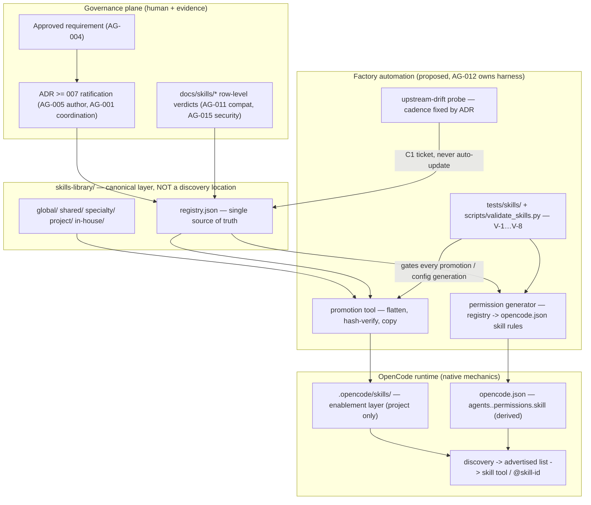
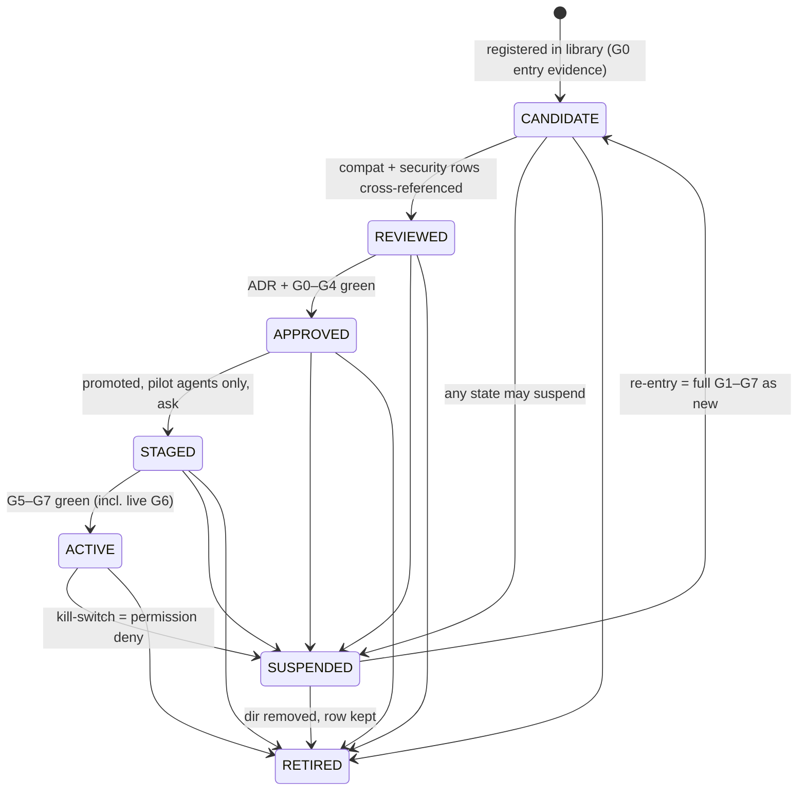

# Skills Governance Architecture

- **doc_id**: SKILLS-GOVERNANCE-0001
- **created_at**: 2026-11-19
- **author**: AG-005 Software Architect
- **status**: ARCHITECTURE DESIGN — normative candidate for ratification by ADR ≥ ADR-007. **Nothing described here is implemented.** No registry, skills directory, permission rule, or automation exists today (verified baseline: AUDIT-0002 F-01…F-05, re-checked 2026-11-19 in SKILLS-REGISTRY-PROPOSAL-0001 §1). This document specifies architecture; it claims no PASS for work not performed.
- **companion**: `docs/skills/SKILLS_REGISTRY_SCHEMA.md` (SKILLS-REGISTRY-SCHEMA-0001) — normative field-level schema for the registry this architecture governs.
- **inputs**: `docs/skills/SKILLS_REGISTRY_PROPOSAL.md` (AG-018) · `docs/skills/SKILLS_COVERAGE_MATRIX.md` (AG-012, V-1…V-8 / A-1…A-11 / G0–G8) · `docs/skills/SKILLS_ADOPTION_PLAN.md` (stages, K-1…K-11, permission posture) · `docs/skills/SKILLS_SECURITY_AUDIT.md` (AG-015) · `docs/skills/SKILLS_COMPATIBILITY_MATRIX.md` (AG-011) · `docs/skills/AUDIT_CURRENT_SKILLS.md` (AUDIT-0002) · `docs/skills/EXTERNAL_SKILLS_RESEARCH.md` (AG-004) · `docs/skills/SKILLS_EXECUTION_EVIDENCE.md` · official OpenCode V2 mechanics summary fetched 2026-11-19 (`/tmp/opencode/skills-work/opencode_skills_official.md`, as cited by the registry proposal) · OpenCode V2 docs index (<https://opencode.ai/v2/docs/>) · `agents/` + `.opencode/agents/` (18-agent catalog).

---

## 1. Purpose, scope, design posture

Give AI-Project-Factory **one auditable, reversible governance system** for every skill it may ever enable: provenance, license, security verdict, permissions, agent assignment, versioning, and lifecycle — across factory agents (scope a) and generated projects (scope b).

Design posture (inherited, non-negotiable):

1. **Fail-closed** (R5.2A): default `deny`; anything unverified is unusable, not "probably fine". Any unmet MUST ⇒ NOT-USABLE (coverage matrix §5).
2. **Evidence over assertion** (A-1…A-11, ADR-003): no gate claims PASS on planned-but-unrun tests; `TBD` stays `TBD` until the real gate runs.
3. **Independent audit** (ADR-004): consumers may not self-approve; security verdicts come from AG-015/AG-003, never from upstream `risk` labels (K-9).
4. **Mechanics honesty**: OpenCode has **no registry concept**. It walks discovery locations and applies registration-order precedence. Everything beyond the fields OpenCode actually interprets is *governance metadata enforced in-house*, never mistaken for runtime enforcement (registry proposal §3.1).
5. **Human approval for remote/critical surfaces** (ADR-002): no HTTP catalog, no bulk installer, no LEVEL C enablement without explicit human approval.

Scope of this document: components, registry location, lifecycle states, permission architecture, versioning/change control, validation (V-1…V-8) and gate (G0–G8) wiring, OpenCode-native usage, multimodel policy, risks, traceability, and escalated requirement gaps. Field-level schema is delegated to the companion document.

## 2. Architecture overview

### 2.1 Component diagram



ASCII fallback (same topology):

```
 requirement ─> ADR(>=007) ─┐
 audit rows (AG-011/015) ───┼─> skills-library/registry.json  [single source of truth]
                            │            │
              V-1…V-8 harness (AG-012)   ├─> promotion tool ─> .opencode/skills/<id>/SKILL.md
              gates every write          └─> permission generator ─> opencode.json (derived)
                                                        │
 drift probe ─> C1 ticket ─> registry                   v
                                          OpenCode discovery + skill tool + @skill-id
```

### 2.2 Components and ownership

| # | Component | Location (proposed) | Responsibility | Owner |
|---|---|---|---|---|
| C-1 | Canonical library | `skills-library/{global,shared,specialty,project,in-house}/` | Versioned, fully described store of every candidate; never discovered by OpenCode directly | AG-018 (provenance rows), AG-012 (structure) |
| C-2 | Registry | `skills-library/registry.json` | One entry per skill: identity, source, license, integrity, verdicts, permissions, assignment, versioning, lifecycle, history | AG-018/AG-012 maintain rows; AG-005 owns schema |
| C-3 | Enablement layer | `.opencode/skills/<skill-id>/SKILL.md` | Promotion copies only — byte-identical or adaptation-marked; the **only** place OpenCode discovers factory skills | AG-012 (promotion), AG-002 (gate chair) |
| C-4 | Validation harness | `tests/skills/`, `scripts/validate_skills.py` | V-1…V-8 offline + live checks; CI job `skills-validation` | AG-012 |
| C-5 | Permission generator | `scripts/` (proposed) | Derive `opencode.json` `skill` rules from registry `assignment`/`permissions`; regenerate, never hand-edit (I-3) | AG-012, review AG-003 |
| C-6 | Gate pipeline | G0–G8 (coverage matrix §6) | Ordered promotion gates with evidence; any FAIL blocks | per-gate owners (§7.2) |
| C-7 | Drift probe | scheduled job (cadence set by ADR) | Diff `integrity.file_hashes` against pinned upstream commit; positive drift ⇒ C1 ticket, never auto-update | AG-012 |
| C-8 | Audit evidence | `docs/skills/*` + adoption manifest | Row-level compat/security verdicts, gate evidence, execution records | AG-011, AG-015, AG-013 |
| C-9 | Decision record | ADR ≥ 007 + `PROJECT_DECISIONS.md` | Ratify this architecture, taxonomy, cadence, permission posture | AG-005 authors, AG-001 coordinates, human approves |

### 2.3 Technology choices (ADR-style decisions, to be folded into ADR ≥ 007)

| ID | Decision | Justification | Rejected alternative |
|---|---|---|---|
| D-1 | **Two layers**: canonical `skills-library/` (not discovered) + enablement `.opencode/skills/` (project layer only) | Official registration order makes later sources win silently; keeping all factory content in the project layer eliminates shadowing in both directions (AUDIT-0002 R-04, AG-004 REC-3, K-2). Library nesting is a human concern; promotion flattens because IDs derive from the `SKILL.md` parent directory only | Direct discovery of nested library tiers (category would vanish from path-derived IDs; collisions surprise); global/compat placement (silent-override hazard) |
| D-2 | **Registry as a single JSON document** (`registry.json`), validated by JSON Schema + in-house lint | Machine-checkable, git-diffable, zero runtime dependencies, reviewable in PRs; OpenCode interprets none of it, so enforcement must live in our CI anyway. Git history + append-only per-row `history` give the audit chain without a database | YAML (weaker schema tooling), SQLite/external registry service (runtime dependency, opaque diffs, overkill for ≤ hundreds of rows) |
| D-3 | **Two metadata planes**: Plane A = SKILL.md frontmatter limited to OpenCode-interpreted fields; Plane B = registry governance fields | Official mechanics read only `name`, `description`, `metadata.opencode/autoinvoke` / `disable-model-invocation`; `license`/`compatibility` are accepted but uninterpreted. Mixing planes creates false confidence that governance metadata is enforced (R-3) | Stuffing governance into frontmatter (uninterpreted ⇒ dead weight, drift risk) |
| D-4 | **Derived permissions**: `opencode.json` `skill` rules are byte-generated from the registry; global default `deny` | Single source of truth; hand-edits are detectable drift (I-3, C5). Per-agent visibility is carved by ordered permission rules (last match wins), not by directory placement | Hand-edited permissions (drift, no audit trail); per-agent directory copies (duplicate IDs ⇒ K-2) |
| D-5 | **Pin + hash everything vendored**: upstream commit SHA, per-file SHA-256, complete directory | Skills are mutable prompt content; pinning is the only defense against silent supply-chain drift (AG-015 rec. 7, K-1). SKILL.md-only vendoring degraded verdicts in the obra snapshot (AG-011 Known Issue 1, K-10) | Floating upstream refs; repo-level license claims as evidence (F-3) |
| D-6 | **Offline-first validation, live gates last**: V-1/2/3/6/7 runnable with zero skills present; V-4/5 live probes only after promotion | Harness-before-inventory (AG-012 rec. 1): first adoption PR is gated on day one; live semantics unverified until G6 (OQ-4, K-7) | Runtime-only testing (nothing to test before adoption; no day-one gate) |
| D-7 | **No HTTP catalogs, no installer skills** in the baseline architecture | Remote catalogs are a supply-chain surface requiring explicit human approval (ADR-002, I-4); `find-skills`-class silent global install is REJECT (K-6) | Catalog-driven auto-adoption (uncontrolled remote content) |
| D-8 | **Model-neutral canonical content** with adaptation-marked local modifications | Factory agents run heterogeneous models/providers; vendor-specific wording is a compatibility defect (AG-011 `hads` class) and a G5 review item (§9) | Per-model skill forks (ID collisions, duplicated concepts, drift) |

## 3. Registry location and directory architecture

Normative layout (from registry proposal §2.1, ratified-with-refinements by the companion schema):

```
AI-Project-Factory/
├── skills-library/                    # CANONICAL — OpenCode never discovers this
│   ├── README.md
│   ├── registry.json                  # single source of truth (companion schema)
│   ├── global/<skill-id>/SKILL.md     # tier: every agent, every project
│   ├── shared/<skill-id>/SKILL.md     # tier: role groups
│   ├── specialty/<category>/<skill-id>/SKILL.md   # tier: one domain (12 categories)
│   ├── project/<project-or-template>/…            # tier: scope-(b) / single project
│   └── in-house/<skill-id>/SKILL.md   # provenance partition (M-1/M-2), same gates
└── .opencode/skills/<skill-id>/SKILL.md           # ENABLEMENT — promotion copies only
```

Rules:

- **L-1** Factory content must never be placed in `~/.config/opencode/skills`, `~/.claude/skills`, `~/.agents/skills`, `.claude/skills`, `.agents/skills` (invariant I-1). Those sources register earlier than the project layer; co-resident IDs create silent overrides.
- **L-2** One directory per skill at the enablement layer; nested library categories are **flattened on promotion** (path-derived IDs use the `SKILL.md` parent only).
- **L-3** Directory form `<id>/SKILL.md` is mandatory whenever supporting files exist; all internal paths are relative to the SKILL.md directory; supporting files are listed (≤ 10 sample paths surfaced) but **never auto-loaded** — prose must say when to read them, and references beyond the sample limit must be enumerated explicitly (A-10).
- **L-4** Library depth stays well inside the official discovery walk limit (≤ 6 levels below a source root, hidden dirs and `node_modules` skipped) even though the library is not a source.
- **L-5** Tier semantics: `global` enabled early once gated; `shared` per stage; `specialty` only where the consumer group exists; `project` never auto-enabled factory-wide (scope-(b) material is exclusively Stage 5).
- **L-6** `in-house` is a provenance partition, not a fifth tier: factory-authored skills face the **same** V-1…V-8 and A-1…A-11 gates (AG-012 rec. 6); they record `source.type: in-house` instead of upstream pins.

Standing invariants (machine-checked, registry proposal §4.3):

| ID | Invariant | Check |
|---|---|---|
| I-1 | Global/compat locations contain no factory-managed content | filesystem walk in V-3 |
| I-2 | Every ID in `.opencode/skills/` has exactly one registry entry, and vice versa (for enabled rows) | V-3 + registry lint |
| I-3 | `opencode.json` `skill` rules are byte-derived from `registry.json` | regenerate-and-diff in CI; failure ⇒ C5 revert-to-registry + G8 log |
| I-4 | No HTTP catalog configured without a registry row carrying human-approval evidence (ADR-002) | config scan in V-4 offline shape check |

## 4. Lifecycle states

Registry `lifecycle` field (states per registry proposal §6; transition guards formalized as X-rules in the companion schema):



| State | Meaning | Enablement | Permission posture |
|---|---|---|---|
| CANDIDATE | In library, intake registered | none (`enabled_in: []`) | n/a (default deny) |
| REVIEWED | Compat (AG-011) + security (AG-015) rows cross-referenced | none | n/a |
| APPROVED | ADR filed + G0–G4 green | none yet | n/a |
| STAGED | Pilot on named agents only | promoted copies exist | **`ask` for all pilot agents**, regardless of risk class |
| ACTIVE | G5–G7 green, live G6 evidence recorded | promoted copies exist | per risk class: A→`allow`, B→`ask`, C→`deny` unless human-approved deviation |
| SUSPENDED | Kill-switch pulled (any state may enter) | copies may remain on disk | **`deny` everywhere** — permission kill-switch is the fast path; no override may relax it |
| RETIRED | Removed from **all** sources | `enabled_in: []`, dirs removed | rules removed; **row kept forever** (append-only history) |

Transition rules:

- **T-1** Every transition appends a `versioning.history` entry (event, date, gates, ADR/evidence refs). Rows are never deleted.
- **T-2** SUSPENDED re-entry runs the **full G1–G7 pipeline as new** — suspension is not a pause button.
- **T-3** Rollback (adoption plan §6): kill-switch (deny) → remove directories from **all** sources for that ID → re-run V-3 (removing a later-source winner can resurrect an earlier-registered copy — the silent-resurrection hazard) → update registry row + records.
- **T-4** Security reclassification (C6) forces immediate SUSPENDED pending review; no agent may self-clear it (ADR-004).
- **T-5** STAGED→ACTIVE requires executed V-4/V-5 on the installed build (G6), per target agent, with results recorded against build version — this is also where OQ-4 is resolved.

## 5. Permission architecture

### 5.1 Native mechanism

OpenCode per-agent `skill` permission (`agents.<id>.permissions`, **ordered rules, last match wins**): `allow` loads silently, `ask` prompts the user, `deny` rejects and hides the skill from the advertised list. `metadata.opencode/autoinvoke: false` removes a skill from the model-driven list while keeping it loadable by exact ID via the `skill` tool and by `@skill-id` manual mention. If both `autoinvoke` and `disable-model-invocation` are present, **autoinvoke wins**.

### 5.2 Factory posture (fail-closed, R5.2A-aligned)

| Risk class (AG-015/AG-012 A-9) | Default rule | Notes |
|---|---|---|
| A | `allow` | allow-list only; LEVEL A vendored skills with ACCEPT verdict |
| B | `ask` | worktree/gitops/CI-CD/migration classes (coverage matrix rec. 7) |
| C | `deny` | LEVEL C = human adjudication (AG-003); any relaxation needs explicit human approval + ADR amendment, recorded in history |

- **P-1** Global default `deny` for `skill`; per-agent `allow`/`ask` rows are **generated** from registry `assignment` + `permissions` (D-4, I-3). `opencode.json` is a derived artifact.
- **P-2** `per_agent_overrides` may **tighten** freely (allow→ask→deny). Loosening beyond the class default requires human-approved evidence in `history`; overrides may never relax a SUSPENDED deny.
- **P-3** Process-class / behavior-injecting skills carry `autoinvoke: false` explicitly in Plane A (K-3, AG-004 REC-3); G5 kills override-class wording ("invoke before ANY response") that conflicts with per-agent contracts.
- **P-4** Assignment is by responsibility category against the verified 18-agent catalog (registry proposal §4.2 mapping); ≥ 1 consumer agent per enabled skill (orphan-enabled skills advertise dead context). Scope-(b) skills are assigned to generated-project agent sets, never factory agents. Deviations are ADR amendments, not ad-hoc permission edits.
- **P-5** Permission semantics are **unverified against the installed build** (OQ-4). Until G6 executes, no permission-dependent claim is evidence; a permission leak (allow where ask) is a hard G6 FAIL.

## 6. Versioning and change control

### 6.1 Version identity (per row)

- `source.commit_sha` + `versioning.upstream_pin` (`<repo>@<sha>`, e.g. `wshobson@4220308`) — the audited supply-chain snapshot; `null` for in-house.
- `versioning.local_rev` — integer, incremented on every local modification (adaptation classes: `wording-model-neutral`, `namespace-rewrite`, `hardening(...)`).
- `versioning.registry_version` — SemVer + build metadata tying the row to its pin (e.g. `0.1.0+pin.4220308`).
- `integrity.file_hashes` — per-file SHA-256 of the exact vendored bytes; the drift probe diffs these against the pinned commit.
- Envelope `schema_version` versions the **registry format itself** (evolution policy in companion schema §10).

### 6.2 Change classes → required re-runs (V-8 trigger matrix, registry proposal §6)

| Class | Change | Required re-run |
|---|---|---|
| C1 | Upstream re-pin (new commit) | V-6, V-7 diff + G3–G6 — a **new supply-chain change**, not a routine bump |
| C2 | Local modification (wording neutralization, namespace rewrite) | compat re-grade (AG-011), V-1–V-3, G5 |
| C3 | Permission/assignment edit | regenerate `opencode.json`, V-4 discovery probe, G4 if class ≥ B |
| C4 | OpenCode version bump | full V-1–V-8 regression; **OQ-4 re-verified every time** (ADR-003) |
| C5 | Docs/config drift (hand-edited `opencode.json`) | I-3 check fails ⇒ revert-to-registry, G8 log entry |
| C6 | Security reclassification | immediate SUSPENDED pending review (T-4) |

### 6.3 Cadence and controls

- Upstream-drift probe runs on a schedule **fixed by the ADR** — this architecture deliberately does not invent an SLA (escalation ES-4). A positive drift opens a C1 ticket; nothing auto-updates.
- Every state transition requires the responsible owner (AG-012 harness, AG-015/AG-003 security, AG-018/AG-012 provenance, AG-002/AG-013 gate closure) and leaves an append-only history entry.
- Deduplication (registry proposal §5) runs at G2 before any promotion and re-runs on any change: (1) exact ID collision = hard fail, seeded with the 11 known cross-repo collision pairs; (2) content duplication (normalized SHA-256 + description fingerprint) = merge decision; (3) concept duplication = **one ID per concept workspace-wide** (REC-3), second skill on a registered concept blocks until the first is retired or explicitly scoped in the ADR.

## 7. Validation architecture: V-1…V-8 and gates G0–G8

### 7.1 V-1…V-8 definitions (normative source: coverage matrix §4; summarized here with architecture wiring)

| Check | Name | What it verifies | Mode | Harness artifact (proposed) |
|---|---|---|---|---|
| **V-1** | Structural validation | Form `<id>.md` or `<id>/SKILL.md`; one skill per directory (no inner search); relative paths resolve from the SKILL.md dir; sanctioned discovery layout; hidden dirs/`node_modules` skipped; ≤ 6 levels below source root | offline | `tests/skills/test_structure.py` |
| **V-2** | Frontmatter validation | YAML parses; non-empty `description` (missing ⇒ never advertised); `name` display-only; `autoinvoke`/`disable-model-invocation` boolean, autoinvoke wins; portability fields uninterpreted — never relied on for gating; **plus in-house ID-pattern lint** (OpenCode does not enforce kebab-case ≤ 64) | offline | `test_frontmatter.py` |
| **V-3** | ID uniqueness & precedence audit | No duplicate path-derived ID across all enabled sources **and** `skills` config array (later registration silently overrides); lowercase-kebab 1–64, case-sensitive; 11-pair collision block-list; one ID per concept; invariants I-1/I-2 | offline | `test_id_uniqueness.py` |
| **V-4** | Discovery smoke test | Advertised list shows exactly the permitted, described set (ID/name/description only); `deny` hides; `autoinvoke:false` hides from model list yet stays loadable by ID/`@skill-id`; config-array relative paths resolve from **working directory, not config file**; catalog shape offline check (I-4) | live (skipped until a skill exists) + offline shape check | `test_discovery.py` |
| **V-5** | Invocation smoke test | `skill` tool loads by exact ID; permission effect per class (allow silent / ask prompt / deny reject); body injected **without frontmatter**; base dir + ≤ 10 supporting paths surfaced, contents not auto-loaded; every referenced relative file exists; `@skill-id` manual load works | live, per skill × target agent (× model, §9) | `test_invocation_<id>.py` |
| **V-6** | Content safety scan | AG-015 pattern set over SKILL.md **and all supporting files**: remote-fetch-and-execute, egress URLs, base64, `/dev/tcp`, destructive commands, sudo, credential shapes, `pull_request_target`, injection markers, frontmatter permission manipulation, executable-asset inventory; fail-closed: unknown ⇒ HOLD; mandatory on **every vendored byte change** | offline | `test_content_scan.py` |
| **V-7** | License / provenance check | Per-file license evidence (repo-level strings are claims); MIT notice retention; Apache-2.0 NOTICE; AGPL ⇒ reject; pinned SHA + recorded hashes; complete directory vendored; aggregator `risk` labels never used as evidence | offline | `test_provenance.py` + adoption manifest |
| **V-8** | Regression checks | Re-run V-1…V-7 on: OpenCode version bump, upstream re-pin, `skills`/`skill`-permission config change, any skills-dir edit; snapshot fixtures for advertised lists | CI job `skills-validation` (path-filtered) + scheduled drift probe | suite wiring + version-bump checklist |

### 7.2 Gate pipeline (normative source: coverage matrix §6; any FAIL blocks promotion; evidence attached per gate)

| Gate | Contents | Owner |
|---|---|---|
| G0 — Governance entry | Requirement approved; ADR ≥ 007 filed; scope (a)/(b) chosen; fail-closed model reconciled with R5.2A; catalogs/bulk-install need human approval (ADR-002) | AG-001 + AG-005 |
| G1 — Static validation | V-1 + V-2 on every PR touching skill dirs | AG-012 |
| G2 — Uniqueness/precedence | V-3 across all sources incl. config arrays; dedup layers 1–3 | AG-012 |
| G3 — License/provenance | V-7 manifest; per-file license; pinned SHA + hashes; complete directory | AG-018/AG-012, sign-off AG-003 |
| G4 — Security | V-6 scan + AG-015 verdict cross-check; ACCEPT-CONDITIONAL conditions closed item-by-item; REJECT/HOLD block | AG-015/AG-003 (LEVEL C = human) |
| G5 — Behavioral compatibility | Process/behavior-injecting wording vs agent contracts; model-neutral wording (`hads` class) | AG-005 + AG-012 |
| G6 — Functional acceptance (live) | V-4 + V-5 on the **installed** build per target agent; resolves OQ-4; results recorded against build version | AG-012 |
| G7 — Release/quality gate | All prior gates green + A-1…A-11 evidenced; manifest updated; doc obligations closed; decision logged | AG-013/AG-015 per audit-contract |
| G8 — Regression cadence | V-8 triggers honored post-adoption; skipped re-run = FAIL | AG-012 |

Per-skill acceptance remains A-1…A-11 (coverage matrix §5), fail-closed. As of 2026-11-19: **0 of 93 candidates satisfy A-8/A-9** — nothing is vendored or runtime-tested; "ready-now" means *ready to onboard*, not *usable*.

## 8. OpenCode-native usage (V2 mechanics the architecture relies on)

Source: official V2 mechanics summary fetched 2026-11-19 (as embedded in the registry proposal / coverage matrix) and the OpenCode V2 docs index. **Caveat (ADR-003, OQ-4): this is a docs snapshot, not live-verified behavior. G6 must re-verify every item below against the installed build, and C4 re-verifies on every version bump.**

1. **Discovery & registration order**: 1 built-ins → 2 `~/.claude/skills` (compat) → 3 `~/.agents/skills` (compat) → 4 `~/.config/opencode/skills` → 5 project `.opencode/skills` → 6 explicit `skills` config entries. **Duplicate IDs: later source wins, silently.** Walk proceeds from cwd up to the project root, max six levels below a source root, skipping hidden dirs and `node_modules`.
2. **Forms & IDs**: `<id>.md` at a source root or `<id>/SKILL.md` in a directory; a directory containing SKILL.md is exactly one skill (no inner search). IDs are **path-derived and case-sensitive**; lowercase-kebab 1–64 is recommended but **not enforced** by V2 ⇒ in-house lint (V-2/V-3) must enforce it.
3. **Advertisement**: the model sees ID/name/description only. `description` is required in practice — no description ⇒ never advertised ⇒ dead weight.
4. **Loading**: the `skill` tool loads by exact ID; the body is injected **without frontmatter**; the skill base dir + up to 10 supporting-file sample paths are surfaced, but supporting contents are **not auto-loaded**. `@skill-id` manual mention loads gated skills.
5. **Model-invocation control**: `metadata.opencode/autoinvoke` / `disable-model-invocation`; autoinvoke wins if both; `autoinvoke:false` ⇒ hidden from the model list, still loadable by ID and `@skill-id`.
6. **Permissions**: per-agent `skill` rules under `agents.<id>.permissions`, ordered, **last match wins**; allow/ask/deny effects as in §5.1.
7. **Configuration**: project config `opencode.json(c)` / `.opencode/opencode.json(c)` with `"$schema": "https://opencode.ai/config.json"`. Config discovery merges ancestors; discovered `.opencode` configs override discovered direct configs — the permission generator (C-5) must target the **effective** project layer. `skills` config-array relative paths resolve from the **working directory, not the config file** (V-4 must test this, not assume it). Config changes hot-reload (skills/agents/permissions re-read on save; `/reload` forces a full reload) — no restart claims in runbooks.
8. **Portability fields**: V2 accepts but does not interpret frontmatter `license` and `compatibility` — governance uses Plane B instead (D-3).
9. **HTTP catalogs** (not enabled, D-7): shape `<base-url>/<name>/<file>` with `index.json`, `SKILL.md` or `<name>.md` entry, cache refresh via version bump. Any future proposal is a remote supply-chain surface: explicit human approval (ADR-002), registry rows with `source.type: http-catalog`, I-4 evidence.

## 9. Multimodel governance

Factory agents run heterogeneous models/providers (each agent definition binds its own model; e.g. AG-005 currently runs `opencode-go/qwen4-max`). Skills are **injected Markdown interpreted by whichever model is executing** — no code runs at load; risk materializes when a model follows instructions (AG-015 §4). Therefore:

| Rule | Policy | Enforced by |
|---|---|---|
| MM-1 | Canonical content is **model-neutral**: no vendor-specific persona, tool-name assumptions, or provider-locked phrasing. Vendor wording found upstream ⇒ adaptation class `wording-model-neutral` (C2), compat re-grade | G5 (AG-005 + AG-012), AG-011 re-grade |
| MM-2 | No model-specific capability assumptions (e.g. "you always have tool X") unless declared in the registry row and gated; skill prose references OpenCode-native surfaces (`skill` tool, `@skill-id`, read-before-use of supporting files), not vendor surfaces | V-2 lint extensions, G5 |
| MM-3 | Description-based triggering must work across the factory's model set: a description that only one model family reliably acts on is a compatibility defect, not a pass | V-5 per model in the approved matrix |
| MM-4 | G6 functional evidence records **model + provider + OpenCode build version** per executed V-4/V-5 run; STAGED→ACTIVE requires coverage of the approved model matrix (matrix itself is a requirement gap, ES-3) | history entries, G6/G7 |
| MM-5 | Permission/autoinvoke semantics are runtime-level, but *model compliance* with ask/deny and instruction-following varies; a permission leak or instruction-override on any matrix model is a hard FAIL, not an averaging exercise | V-4/V-5, G6 |
| MM-6 | No per-model skill forks. One ID per concept workspace-wide (REC-3); model differences are handled by neutral wording + per-model evidence, never by duplicate IDs | V-3, dedup layer 3 |
| MM-7 | Frontmatter `compatibility` portability field is documentation only (uninterpreted by V2); model-compatibility claims live in Plane B verdicts with row-level evidence | D-3, V-2 |

## 10. Risk architecture

Traceable to the adoption plan register (K-1…K-11); architectural mitigations are the components/rules above:

| Risk | Essence | Architectural mitigation | Verified by |
|---|---|---|---|
| K-1 | Mutable prompt supply chain / upstream drift | D-5 pins + hashes; C1 = new supply-chain change; drift probe never auto-updates | V-6/V-7, G3–G6, G8 |
| K-2 | Silent ID-collision precedence (later source wins) | D-1 project-only enablement; I-1/I-2; 11-pair block-list; one-ID-per-concept | V-3, G2 |
| K-3 | Behavior injection vs per-agent contracts | P-3 `autoinvoke:false`; G5 wording review; override-class skills excluded by default | V-2/V-5, G5 |
| K-4 | License exposure (AGPL, NOTICE, unverifiable per-file) | Plane B per-file license evidence; AGPL never ACTIVE; LICENSE/NOTICE vendored | V-7, G3 |
| K-5 | Aggregator provenance (re-hosting, churn, rename) | HOLD/REJECT rows excluded; re-pin canonical identity + SHA before any re-collection; dedup layers 1–2 at ingest | V-3/V-7, G2/G3 |
| K-6 | Installer-class skills (silent global installs) | D-7 no catalogs/installers; `find-skills` REJECT upheld; discovery stays human-run | I-4, G0/G4 |
| K-7 | Unverified runtime semantics (OQ-4) | D-6 offline-first; G6 live verification hard exit; no PASS on unrun tests | V-4/V-5, G6 |
| K-8 | Fit gaps (Postgres-vs-SQLite, K8s-vs-LXC) | Tier `project`/scope-(b) isolation; Stage 5 only; bucket ≠ promotion | G0 scope choice, G5 |
| K-9 | Input data quality (TBD taxonomy, undefined `risk` labels) | Verdicts only from AG-015 rows; taxonomy frozen only after OQ-1 ratification (ES-1) | G2/G4, schema enums |
| K-10 | Snapshot incompleteness (SKILL.md-only clones) | `complete_directory: true` + full hash coverage before G5 | V-7, G3 |
| K-11 | Documentation drift (PROJECT_MAP overstatement) | A-11 doc obligations per stage; this document claims nothing implemented | G7 |
| GOV-1 | Registry/config drift (hand-edited permissions) | D-4 derived config; I-3 regenerate-and-diff; C5 revert-to-registry | CI invariant check, G8 |
| GOV-2 | Silent resurrection on rollback (removing winner exposes earlier copy) | T-3 removal targets **all** sources + V-3 re-run | rollback checklist |
| GOV-3 | Governance metadata mistaken for enforcement | D-3 two planes; schema doc states enforcement boundaries explicitly | V-2, G6 |
| GOV-4 | Multimodel instruction-following variance | MM-1…MM-7; per-model G6 evidence | V-5 matrix runs |

## 11. Traceability

| Requirement / evidence source | Architecture decision | Schema element (companion doc) | Validation | Evidence artifact |
|---|---|---|---|---|
| R5.2A fail-closed posture | D-4, P-1…P-5 | `permissions`, X-4/X-5 | V-4/V-5, G4/G6 | derived `opencode.json`, probe transcripts |
| AUDIT-0002 R-04 / AG-004 REC-3 | D-1, L-1/L-2 | `enabled_in`, X-9 | V-3, I-1/I-2 | discovery audit report |
| AG-015 rec. 7 (mutable content) | D-5, C1 | `source`, `integrity`, `versioning.upstream_pin` | V-6/V-7 | adoption manifest, drift logs |
| AG-011 Known Issue 1 (incomplete vendoring) | L-3, D-5 | `integrity.complete_directory`, X-6 | V-7, G3 | hash manifest |
| AG-012 §4 (V-1…V-8) | C-4, D-6 | lint rules §9 of schema doc | CI `skills-validation` | test reports |
| AG-012 §5 (A-1…A-11) | T-5, G7 | `verdicts`, `history` | G7 evidence review | gate evidence rows |
| AG-012 §6 (G0–G8) | §7.2 pipeline | `lifecycle` X-rules | state-machine lint | append-only history |
| ADR-002 (human approval) | D-7, I-4 | `source.type: http-catalog` + approval evidence | V-4 offline shape | human approval record |
| ADR-003 / OQ-4 (installed build) | §8 caveat, T-5, C4 | `history` build-version fields | V-4/V-5 live, G6 | G6 report vs build version |
| ADR-004 (independent audit) | §7.2 owners, T-4 | `verdicts.verified_by`, `license.verified_by` | G3/G4/G7 sign-off | audit cross-refs (row-level, OBS-1) |
| AG-004 F-4 / K-3 (behavior injection) | P-3, G5 | `permissions.autoinvoke`, Plane A | V-2/V-5 | G5 review record |
| AG-011 `hads` class / model neutrality | D-8, MM-1…MM-7 | `integrity.local_modifications` | C2 re-grade, V-5 matrix | compat re-grade rows |

## 12. Requirement gaps — escalations (AG-005 → AG-001)

Per my mandate, gaps are escalated, not papered over:

| ID | Gap | Blocks | Escalate to |
|---|---|---|---|
| ES-1 | **OQ-1**: 14-category taxonomy is analyst construction, unratified | freezing `category` enum; G0 exit | AG-004/AG-001 via Stage-0 ADR |
| ES-2 | **OQ-4**: installed-build semantics (autoinvoke, per-agent skill permissions, precedence) never live-verified | STAGED→ACTIVE; any permission-dependent claim | AG-012 (G6 first run) |
| ES-3 | **No approved multimodel test matrix** (which models/providers constitute factory coverage) | MM-4 coverage claims at G6/G7 | AG-001 + AG-004 (requirement amendment) |
| ES-4 | **Drift-probe cadence/SLA unset** (proposal deliberately invents none) | C7 scheduling; G8 cadence evidence | ADR ≥ 007 ratification (human) |
| ES-5 | **Compatibility verdict vocabulary not frozen as machine enums** (provisional list in schema doc §4) | schema validation strictness | AG-011 |
| ES-6 | **OBS-1**: security-audit summary counts diverge from its own rows (49/11 vs 51/9) | adoption counting; strict-ACCEPT ready-now buckets | AG-015 reconcile + re-state |
| ES-7 | **Duplicate ADR-005 numbering** (AUDIT-0002 F-12/R-05) | filing ADR ≥ 007 on a clean log | AG-018/AG-001 reconcile first |
| ES-8 | **In-house license policy** for M-1/M-2 factory-authored skills undefined | G3 for in-house rows | AG-003 at G0/G3 |

## 13. Acceptance of this design, and limitations

This architecture is acceptable for ADR review when: (a) every component C-1…C-9 has a named owner and a proposed artifact path; (b) every decision D-1…D-8 cites mechanics or audit evidence; (c) V-1…V-8 and G0–G8 are wired without redefining their normative sources; (d) all gaps are escalated (§12); (e) the companion schema validates the registry proposal's field obligations without contradicting them (refinements are flagged, not silent).

Limitations: nothing here is implemented or installed; OpenCode mechanics are a fetched-docs snapshot pending G6/OQ-4 re-verification; the taxonomy and model matrix are pending ratification; this tasking wrote only the two `docs/skills/` files — no commits, configuration changes, agent-definition changes, or `PROJECT_DECISIONS.md` edits (decisions D-1…D-8 are staged for the ADR and the decision log at ratification).
