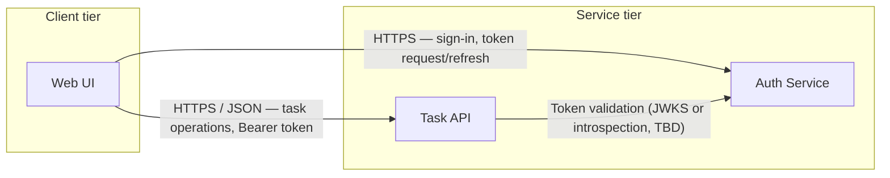

# Component Diagram — PROJECT-001

> **Doc type:** Architecture artifact (owner: AG-005 Software Architect)
> **Date:** 2026-11-04
> **Status:** Draft v0.1
>
> ⚠️ **Traceability caveat:** Per the instruction for this pass, the requirements
> documents under `projects/PROJECT-001/requirements/` were **not read**. All REQ IDs
> below are **provisional placeholders** grouped by capability area. They must be
> reconciled against the approved requirements baseline before this diagram is
> accepted. See §5 (Open Questions).

## 1. Scope

Covers the three components in scope for this pass: **Web UI**, **Task API**, and
**Auth Service**. Data stores, message brokers, and deployment topology are out of
scope pending requirements reconciliation (see OQ-2).

## 2. Component diagram

## 3. Components

### 3.1 Web UI

| Attribute | Value |
|---|---|
| Type | Single-page web application (technology TBD — see OQ-4) |
| Calls | Task API, Auth Service |
| Called by | End users (browser) |

**Responsibilities**
- Present task lists and task detail views; capture create/update/complete actions.
- Client-side input validation with server results taking precedence.
- Authenticate users via the Auth Service; acquire, store, and refresh access tokens.
- Attach the Bearer token to Task API calls; surface authentication/authorization failures.

**Related REQ IDs (provisional)**
- `REQ-UI-001` — View and filter task list
- `REQ-UI-002` — Create and edit a task via forms
- `REQ-UI-003` — Sign in / sign out and session token handling
- `REQ-UI-004` — Display validation and authorization errors

### 3.2 Task API

| Attribute | Value |
|---|---|
| Type | HTTP/REST service |
| Calls | Auth Service (token validation); task data store (out of scope here) |
| Called by | Web UI |

**Responsibilities**
- Expose CRUD endpoints for tasks (create, read, update, delete, status transitions).
- Enforce authentication and authorization on every request using tokens validated by the Auth Service.
- Validate task payloads and enforce business rules for task state.
- Persist task state; return structured success/error responses.

**Related REQ IDs (provisional)**
- `REQ-TASK-001` — Create a task
- `REQ-TASK-002` — List and retrieve tasks
- `REQ-TASK-003` — Update a task / change task status
- `REQ-TASK-004` — Delete a task
- `REQ-TASK-005` — Reject unauthenticated/unauthorized access

### 3.3 Auth Service

| Attribute | Value |
|---|---|
| Type | HTTP/REST identity service |
| Calls | User/credential store (out of scope here) |
| Called by | Web UI, Task API |

**Responsibilities**
- Authenticate users against registered credentials.
- Issue short-lived access tokens and support refresh/expiration.
- Provide token validation to the Task API (mechanism TBD — see OQ-3).
- Define roles/claims used for task-level authorization decisions.

**Related REQ IDs (provisional)**
- `REQ-AUTH-001` — User sign-in (and registration if in scope)
- `REQ-AUTH-002` — Token issuance with expiry
- `REQ-AUTH-003` — Token refresh and revocation
- `REQ-AUTH-004` — Role/claim definition for authorization

## 4. Interfaces

| # | From → To | Protocol / Contract | Data | Provisional REQs |
|---|---|---|---|---|
| I1 | Web UI → Task API | HTTPS, JSON REST; `Authorization: Bearer` | Task resources | REQ-TASK-001..005, REQ-UI-001..002 |
| I2 | Web UI → Auth Service | HTTPS; sign-in/token endpoints | Credentials, tokens | REQ-AUTH-001..003, REQ-UI-003 |
| I3 | Task API → Auth Service | Token validation (JWKS vs introspection TBD) | Tokens, claims | REQ-TASK-005, REQ-AUTH-002..004 |

## 5. Open Questions / Escalations

- **OQ-1 (Traceability):** REQ IDs above are provisional because the requirements
  baseline (`requirements/FUNCTIONAL_REQUIREMENTS.md` et al.) was not consulted in this
  pass, per instruction. **Action:** reconcile every ID against the approved baseline and
  remove any requirement not actually present; add uncovered components/requirements.
- **OQ-2 (Completeness):** Task and user persistence are implied by the responsibilities
  but no datastore components are diagrammed. Decide whether to extend the diagram or
  treat stores as external infrastructure.
- **OQ-3 (Decision needed):** Token validation mechanism (self-contained JWT + JWKS vs.
  opaque token introspection) — candidate ADR; impacts I3 and NFRs (latency, logout).
- **OQ-4 (Decision needed):** Web UI framework choice — requires technology criteria from
  NFRs and team constraints — candidate ADR.

## 6. Change log

| Version | Date | Author | Notes |
|---|---|---|---|
| 0.1 | 2026-11-04 | AG-005 | Initial draft; provisional REQ IDs pending requirements reconciliation |

